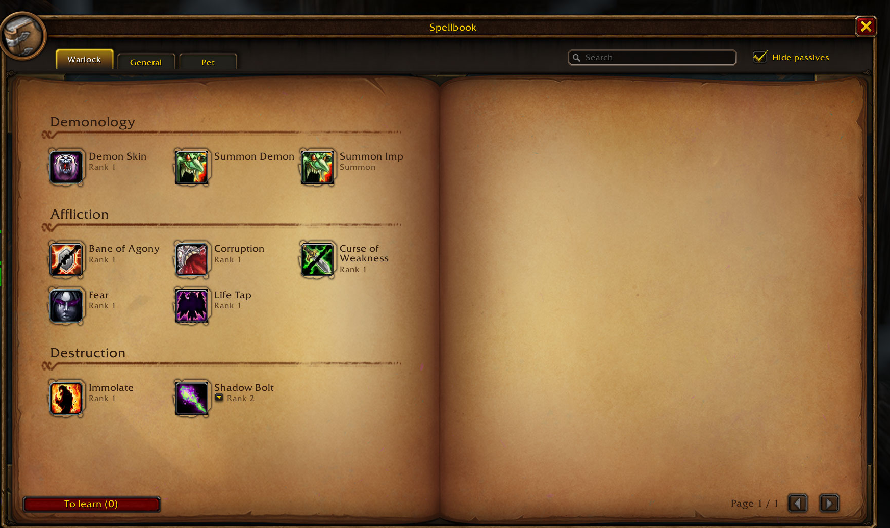
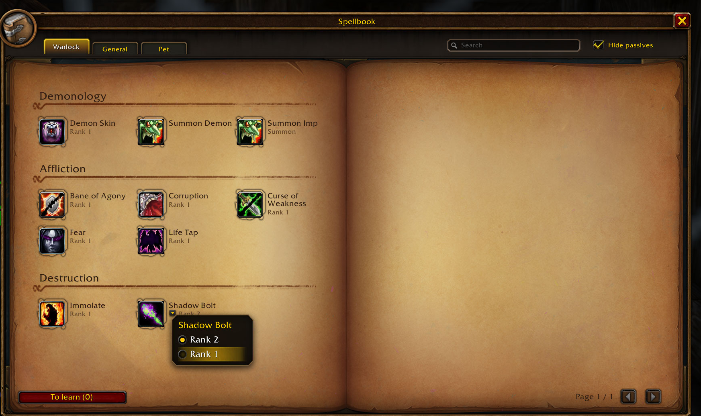
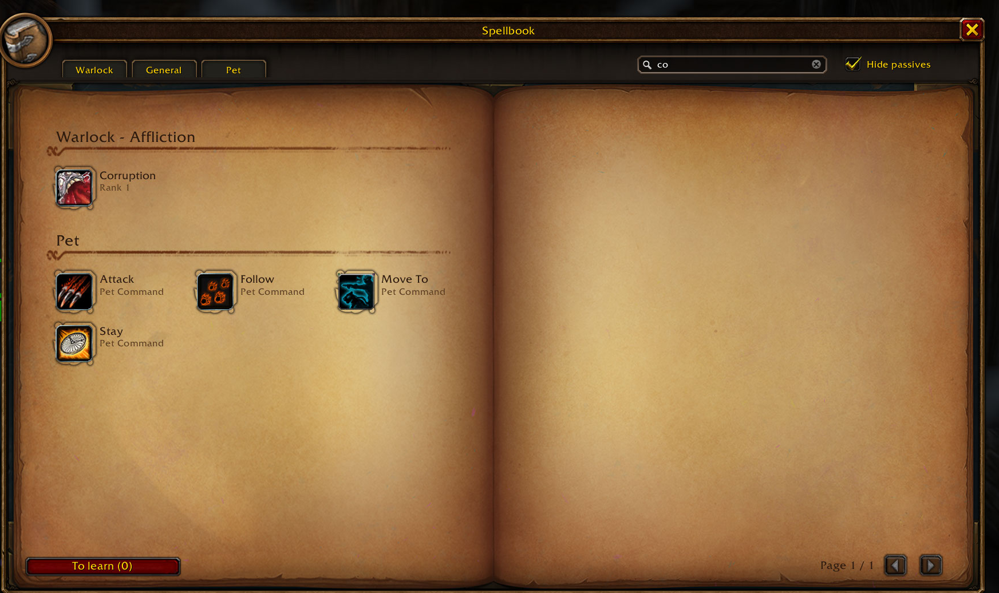

# Retail Spellbook

Addon para World of Warcraft: Forever. Cambia la organización del libro de hechizos por la de retail.

## Qué hace

El libro de Forever tiene una pestaña de icono por cada escuela (General, Arcano, Fuego, Escarcha...).
Este lo organiza como el de retail:

- Pestañas arriba con nombre: **tu clase**, **General** y **Mascota** (si tienes).
- En la pestaña de clase, todas tus escuelas seguidas, cada una con su encabezado.
- Dos páginas abiertas con tres columnas, rueda del ratón o flechas para pasar página.
- Buscador (busca en todas las pestañas, sin tildes ni mayúsculas) y casilla «Ocultar pasivas».
- Clic: lanza el hechizo. Arrastrar: a la barra de acción. Mayús+clic: enlace en el chat.
  Mascota: clic derecho activa o quita el lanzamiento automático.

Se abre con la **tecla del libro** que ya tengas (P por defecto) y con `/libro`. La opción «Abrir con
la tecla del libro» devuelve la tecla al libro de Blizzard. El botón del menú inferior sigue abriendo
el de Blizzard.

## Un hechizo por rango

Forever pone cada rango como una entrada aparte del libro. Aquí cada hechizo sale una vez y lanza el
rango aprendido más alto. La flecha junto al rango, o el clic derecho sobre el hechizo, abre un
desplegable para elegir otro (para ahorrar maná, por ejemplo); la elección se guarda por personaje.
En combate no se puede cambiar. Se desactiva con la opción «Un hechizo por rango».

La búsqueda mira en todas las pestañas a la vez:

## Con What's Training?

What's Training? pinta su lista de hechizos por aprender encima del libro de Blizzard, que este
sustituye, así que con él solo no se veía. Si está instalado, el libro muestra abajo a la izquierda
el botón **«Por aprender (N)»**: N son los hechizos disponibles ya en tu instructor y, al pasar el
ratón, su coste total. El clic abre la ventana de What's Training (la misma que `/wt`), con la lista,
los precios y dónde está el instructor. Sin ese addon el botón no aparece.

## Por qué es un libro propio

El de Blizzard lanza los hechizos desde su propio código; si un addon cambia cómo arma sus pestañas,
lanzar desde él da «acción bloqueada». Aquí cada hechizo es un botón seguro que lanza sin ese problema.
El precio: **en combate** la página, la pestaña y la búsqueda se quedan fijas (abrir, cerrar y lanzar
sí funcionan). Se actualiza al salir de combate.

## Comandos

- `/libro` o `/retailspellbook`: abre o cierra el libro (fuera de combate).
- `/retailspellbook config`: opciones (tecla, ocultar pasivas, un hechizo por rango, escala).
- `/retailspellbook debug`: diagnóstico para informar de un problema.

## Estado

Publicada la 0.2.0 en CurseForge (06-11-2026); los rangos y el arreglo del buscador están sin publicar.
Pasa las comprobaciones fuera del juego (111 tests, 07-11-2026). Visto en el cliente (07-11-2026, brujo
nivel 5): pestañas Clase / General / Mascota con encabezados por escuela, botón de cerrar, una entrada
por hechizo con su desplegable de rangos, y la búsqueda con su X. Pendiente de ver en el cliente:

1. Lanzar desde el libro en combate, sin «acción bloqueada» (BugSack).
2. Clic derecho en un hechizo de mascota cambia el autolanzamiento.
3. Hechizos con desplegable propio de Blizzard (flyouts), si la clase los tiene.
4. Con What's Training activo: «Por aprender (N)», el coste en su tooltip y su ventana al hacer clic.
